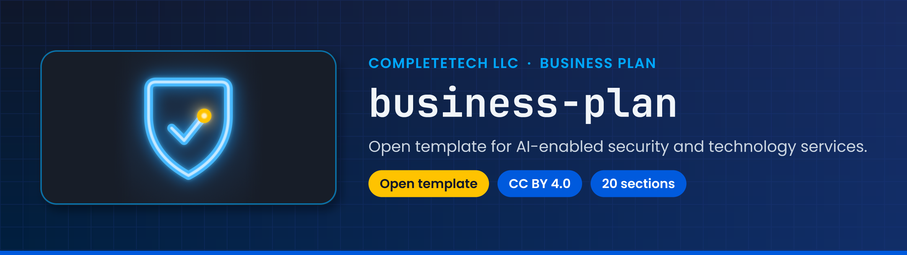

<!-- showcase:banner:start -->
<p align="center">
  
</p>
<!-- showcase:banner:end -->

<!-- showcase:nav:start -->
**CompleteTech Security** · [All repositories](https://github.com/CompleteTech-Security) · [Contributing](https://github.com/CompleteTech-Security/.github/blob/main/CONTRIBUTING.md) · [Security](SECURITY.md)
<!-- showcase:nav:end -->

<div align="center">

# Business Plan Template

<!-- showcase:badges:start -->


<!-- showcase:badges:end -->

<!-- showcase:tagline:start -->
**Create a company-neutral business plan for an AI-enabled security and technology services practice.**
<!-- showcase:tagline:end -->

</div>

---

## About

An open, company-neutral template for a security-assessment, managed-services, and AI-automation practice. It was originally developed by CompleteTech LLC and is published so other people can learn from it, adapt it, and build their own businesses with AI.

It covers customer segments, an authorization-first assessment workflow, service packages and pricing experiments, a 12-month roadmap, KPIs, risks, a legal and compliance checklist (Section 17), and how to adapt the model to other AI-enabled services (Section 18).

> [!IMPORTANT]
> This is general information, not legal, financial, tax, or security advice. Every price and revenue figure is an illustrative assumption, not a forecast or a promise of income. Only test systems you own or have written permission to test. See Section 19 of the plan and [NOTICE.md](NOTICE.md).

## Install

```bash
git clone https://github.com/CompleteTech-Security/business-plan.git
cd business-plan
```

Or use the files directly: [business-plan.pdf](business-plan.pdf) and [business-plan.html](business-plan.html) need no tooling.

## Quick Start

1. Read [business-plan.pdf](business-plan.pdf) or open [business-plan.html](business-plan.html) in a browser (self-contained, light and dark).
2. Read Section 17 (legal and compliance) and Section 19 (disclaimers) before acting on anything.
3. Replace the worked example with your own capability, market, and numbers, following Section 18.

## Usage

Edit [business-plan.md](business-plan.md), then rebuild the HTML:

```bash
pip install markdown
python scripts/build_plan.py
```

`build_plan.py` renders `business-plan.md` to a brand-neutral `business-plan.html`. Print that file to PDF from a browser to refresh `business-plan.pdf`.

## Development

Corrections and improvements are welcome through issues and pull requests under the same license. Keep the plan company-neutral: use "the Company" for the reader's business and mark examples as examples.

## License

Licensed under CC BY 4.0; see `LICENSE`. CompleteTech LLC names and logos are reserved and are not licensed for reuse except to identify this project. Software in the linked repositories is governed by its own license.

<!-- showcase:footer:start -->
<p align="center">
  <a href="https://www.complete.tech">
    <picture>
      <source media="(prefers-color-scheme: dark)" srcset="https://raw.githubusercontent.com/CompleteTech-LLC/.github/main/brand/logo-dark.png">
      
    </picture>
  </a>
  <br>
  Built by <a href="https://www.complete.tech">CompleteTech LLC</a> · Innovation at Every Integration
</p>
<!-- showcase:footer:end -->
